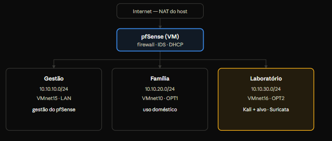
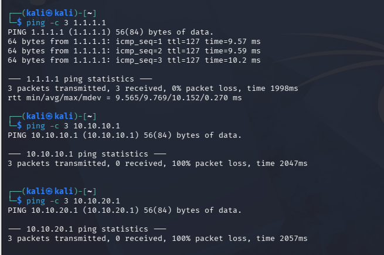
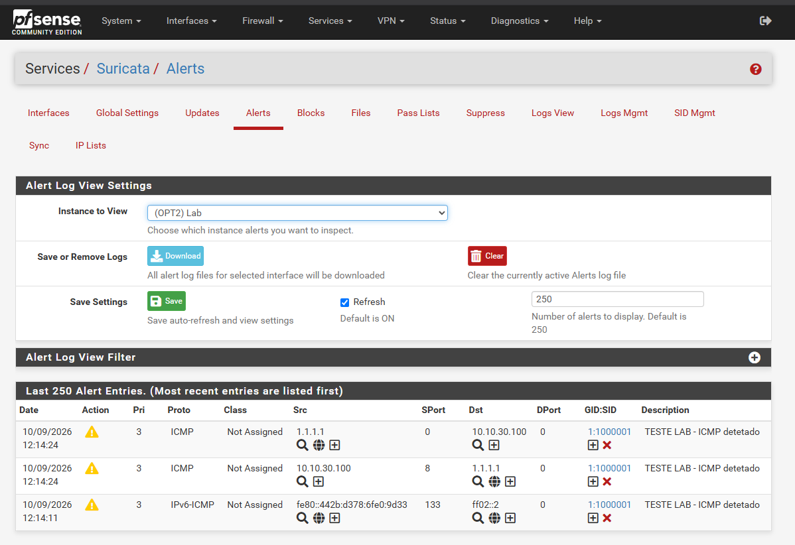

# Laboratório de Segmentação de Rede (pfSense + Suricata)

Laboratório de segurança de rede que demonstra, de ponta a ponta, **segmentação de rede, política de firewall por defeito-negar e deteção de intrusões (IDS)**. Uma firewall pfSense separa três redes isoladas (gestão, uso doméstico e laboratório), com regras explícitas entre elas e um IDS Suricata a inspecionar o segmento de laboratório. O ambiente é inteiramente virtualizado (VMware Workstation), e o isolamento e a deteção foram validados com testes documentados a partir de uma máquina atacante Kali Linux.

`pfSense CE 2.7.2` · `Suricata` · `Segmentação de rede` · `VMware Workstation` · `Kali Linux` · `CIS Controls v8` · `NIST CSF`

## Objetivo e competências

Projetar, implementar e **validar** um ambiente que contém o raio de impacto de um comprometimento: uma rede de laboratório onde se corre software malicioso não pode alcançar a rede de uso doméstico nem a de gestão, e todo o seu tráfego é vigiado por um IDS.

- Projeto e implementação de **segmentação de rede** (sub-redes isoladas por interface)
- **Firewall stateful** com política *deny-by-default* e aliases
- **Deteção de intrusões** com Suricata (ET Open) e **escrita de assinaturas personalizadas**
- Diagnóstico e resolução de problemas reais (conflitos de IP, mapeamento de interfaces, DNS, afinação do IDS)
- Documentação técnica e **mapeamento a frameworks** (CIS Controls v8, NIST CSF)

## Arquitetura



| Segmento | Sub-rede | Rede VMware | Interface pfSense | Conteúdo |
| --- | --- | --- | --- | --- |
| Gestão | 10.10.10.0/24 | VMnet15 | LAN | administração do pfSense |
| Família | 10.10.20.0/24 | VMnet10 | OPT1 | dispositivos de uso doméstico |
| Laboratório | 10.10.30.0/24 | VMnet16 | OPT2 | Kali (atacante) + alvos; vigiado pelo Suricata |
| WAN | — | NAT (VMnet8) | WAN | saída para a internet |

## Implementação

**Firewall — política *deny-by-default*.** As interfaces dos segmentos nascem sem regras (bloqueiam tudo) e as permissões são explícitas. Um alias `RedesPrivadas` (as três sub-redes internas) permite bloquear o tráfego entre segmentos numa só regra.

| Origem | Destino | Ação |
| --- | --- | --- |
| Laboratório (OPT2) | gateway / DNS (10.10.30.1) | Permitir |
| Laboratório (OPT2) | RedesPrivadas | **Bloquear** |
| Laboratório (OPT2) | Internet | Permitir |
| Família (OPT1) | RedesPrivadas | Bloquear |
| Família (OPT1) | Internet | Permitir |
| Gestão (LAN) | qualquer | Permitir |

Como as regras são avaliadas por ordem, o bloqueio às redes internas é lido **antes** da permissão de internet — o resultado é acesso à internet **sem** acesso lateral.

**IDS — Suricata.** Ativado na interface do laboratório (OPT2), em modo de deteção. Rulesets ET Open com `emerging-scan` e `emerging-attack_response`, mais uma assinatura personalizada. O *hardware offloading* foi desligado, como o Suricata exige.

## Validação (provas)

**Prova 1 — Segmentação seletiva.** Três pings a partir do laboratório (Kali, 10.10.30.100):

| Destino | Significado | Resultado |
| --- | --- | --- |
| 1.1.1.1 | Internet | 0% de perdas — permitido |
| 10.10.10.1 | Gestão | 100% de perdas — bloqueado |
| 10.10.20.1 | Família | 100% de perdas — bloqueado |



**Prova 2 — Deteção pelo IDS.** Tráfego da Kali detetado pelo Suricata na OPT2, com origem, destino e assinatura registados.



## Regra de deteção personalizada

As regras de scan do ET Open são afinadas para tráfego de fora para dentro; o reconhecimento a sair do laboratório não lhes correspondia. Para validar o motor de deteção, foi escrita uma assinatura própria:

```
alert icmp any any -> any any (msg:"TESTE LAB - ICMP detetado"; sid:1000001; rev:1;)
```

Após recarregar o Suricata, um `ping` da Kali passou a gerar o alerta, confirmando a inspeção em ambos os sentidos — e demonstrando a capacidade de escrever deteções à medida.

## Problemas encontrados e resolução

- **Arranque preso na ISO** (estado "Amnesiac") — a ISO continuava ligada no arranque; resolvido desligando o *Connect at power on*.
- **Interfaces trocadas** — a ordem dos adaptadores na VM não coincidia com a atribuição no pfSense; diagnosticado comparando a ordem (em0–em3) com o estado dos links.
- **Conflito de IP na gestão** — host e pfSense reclamavam o `10.10.10.1`; resolvido com um IP distinto (`10.10.10.50`) no host.
- **DNS bloqueado pela segmentação** — a regra deny-by-default barrava o DNS ao gateway; resolvido com regra explícita à porta 53.
- **IDS "sem alertas"** — o `suricata.log` confirmou o motor saudável; faltava uma assinatura para o tráfego de saída, resolvida com a regra personalizada. Lição: distinguir "o IDS não funciona" de "não há assinatura para este tráfego".

## Mapeamento a frameworks

| Controlo implementado | CIS Controls v8 | NIST CSF |
| --- | --- | --- |
| Segmentação de rede | 12 · 4 | PR.AC / PR.PT |
| Firewall deny-by-default | 4 · 12 | PR.AC |
| IDS + registo de eventos | 13 · 8 | DE.CM / DE.AE |
| Rede de gestão separada | 12 | PR.AC |

## Stack e próximos passos

**Tecnologias:** pfSense CE 2.7.2 · Suricata (ET Open) · VMware Workstation Pro · Kali Linux · nmap · FreeBSD.

**Próximos passos:** VM alvo vulnerável para scans internos · DNS via pfSense Resolver · reencaminhamento de logs para SIEM (Wazuh/Elastic) · domínio Active Directory no laboratório · Suricata em modo IPS.
